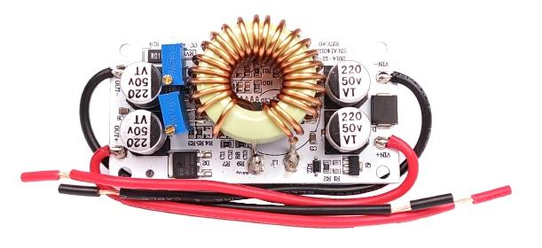
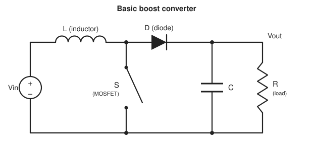
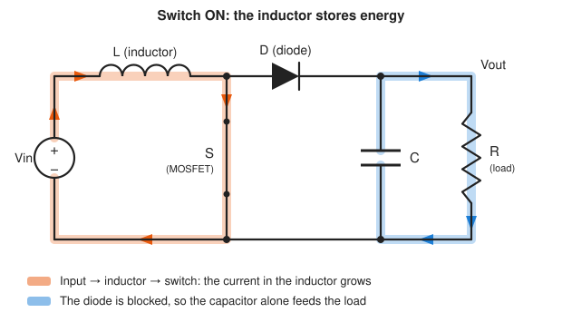
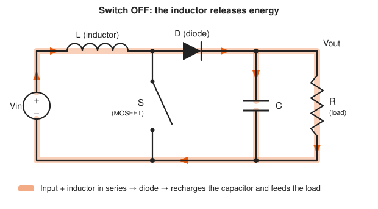
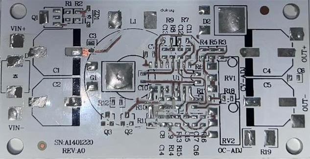

# 250 W DC-DC Boost Converter: Reverse Engineering

<p align="center">
  
</p>

*The module analysed: a commercial 250 W, non-isolated DC-DC **boost** (step-up) converter with adjustable output voltage and adjustable current limit. It is built around a **TL494C** PWM controller, on an aluminium PCB.*

In this project I took this module apart to find out how it works: I desoldered it, traced the copper, identified every component, redrew the schematic in **LTspice**, simulated it and tested it on the bench. This README is mostly about **what I learned**, and above all about **how a boost converter works**.

> Project developed for the course **Power Electronics**, BSc in **Electrical and Computer Engineering**, **Instituto Politécnico do Cávado e Ave (IPCA)**, **3rd year**.

---

## Repository structure
 
```
.
├── simulations/    # LTspice simulations
├── board/          # information about the board
├── images/         # photos of the board
└── README.md
```

- **`simulations/`:** two LTspice simulations. A **basic** one, with just the power stage of the boost, and a **more complete** one, with the full reconstructed schematic including the TL494C controller. The complete one is **not 100% functional** (more on this below).
- **`board/`:** the datasheets of all the components on the board, the component list and the block diagram of the module.
- **`images/`:** photos of the complete board and of the bare board, with no components, and the diagrams of the basic boost circuit used in this README.

---

## How a boost converter works

### The basic idea

A boost converter takes a DC voltage and produces a **higher** DC voltage. It cannot be done with a resistor or a simple linear regulator, which can only lower a voltage. Instead, a boost converter **stores energy and then releases it at a higher voltage**. It does so using four main parts:

- an **inductor**, which stores energy in a magnetic field;
- a **switch** (a MOSFET), turned on and off very fast;
- a **diode**, which only lets current flow towards the output;
- **capacitors** at the output, which keep the voltage steady.

This is the basic circuit, with the load (R) connected to the output:



### The two phases

The switch is turned on and off over and over, around a hundred thousand times per second. Each cycle has two phases.

**Switch ON.** The input voltage is applied across the inductor, and the current through it grows steadily. The inductor is charging, storing energy. In this phase the diode is blocked by the higher voltage that is already at the output, so the output is cut off from the input. The load is powered by the energy stored in the output capacitors.



**Switch OFF.** The inductor does not like its current being interrupted, so it fights the change: its voltage flips around and **adds to the input voltage**. This combined voltage is higher than the input, enough to open the diode and push the stored energy into the output capacitors and the load.



That is why the output voltage is always higher than the input voltage: during the OFF phase, the output sees *the input plus the voltage the inductor generates*.

### The duty cycle

The fraction of each cycle that the switch stays ON is called the **duty cycle**. It is the knob that sets the output voltage:

- the longer the switch stays on, the more energy the inductor stores in each cycle, and the higher the output voltage;
- if the input is close to the wanted output, the duty cycle is small, and if a large step-up is needed, it is large.

The converter does not fix the duty cycle once. A **feedback loop** keeps adjusting it to compensate for changes in the load or in the input voltage, so the output stays where the user set it.

### Why it is efficient

The switch is always either fully on or fully off, never half-way. When it is off it carries no current, and when it is on there is almost no voltage across it, so very little power is wasted as heat. The losses that remain happen mostly in the MOSFET: while it conducts (because of its small resistance) and during the short moments when it changes state.

---

## How this particular module does it

### Power stage

- **MOSFET:** a fast N-channel MOSFET does the switching.
- **Gate driver:** the controller's output is too weak to charge and discharge the MOSFET's gate quickly. A pair of transistors, one NPN and one PNP, sits between them: one charges the gate and the other discharges it. This makes the switching transitions fast, which reduces switching losses.
- **Diode:** a **Schottky** diode is used because it switches very fast and has a low voltage drop, so it wastes little energy.
- **Output filtering:** large electrolytic capacitors work as an energy reservoir for the load, and a small ceramic capacitor in parallel absorbs the high-frequency noise that the electrolytics cannot handle.

### The brain: TL494C

The TL494C is a PWM controller that already contains most of what a switching converter needs:

- an **oscillator**, whose frequency is set by one resistor and one capacitor connected to it, and which generates a sawtooth ramp that is the timebase of everything;
- **two error amplifiers**, which compare the real output with what the user asked for;
- a **PWM comparator**, which compares the sawtooth with the error signal to decide for how long the switch stays on in each cycle;
- a **dead time** control, which keeps the switch from ever being on for the whole period;
- a stable **5 V reference**, used to feed the setpoint potentiometers.

### Voltage regulation

The high output voltage is scaled down by a resistor divider and fed to one of the error amplifiers. A potentiometer, powered by the 5 V reference, sets the voltage the user wants. If the output voltage falls, for example because the load increased, the error amplifier notices the difference and makes the switch stay on longer, which brings the voltage back up.

### Current limiting, and constant voltage / constant current

A very small resistor in the ground line works as a **current sensor**: the more current flows, the bigger the small voltage across it. That voltage goes to the second error amplifier, which compares it with a second potentiometer that sets the current limit.

The two error amplifiers are combined so that **the one asking for the shorter ON time wins**:

- Normally the load draws less than the limit, the current amplifier stays quiet and the module works as a **constant voltage** source.
- If the load tries to draw more than the limit, the current amplifier takes over and reduces the duty cycle. The output voltage drops just enough to hold the current at the limit, and the module is now a **constant current** source.

The change between the two modes is smooth and automatic, with no extra switching logic. I found this one of the most elegant parts of the design.

### Other details I found on the board

- **Soft start:** a small resistor-capacitor network on the controller's feedback pin makes the duty cycle start small and grow gradually at power-up, avoiding a big current spike.
- **Reverse polarity protection:** a Schottky diode at the input blocks current if the supply is connected the wrong way round.
- **Input filtering:** capacitors at the input smooth the supply and supply the current peaks that the converter draws.
- **Auxiliary supply for the controller:** a zener diode and an NPN transistor, working as an emitter follower, turn the variable input voltage into a steady supply of about 17 V for the controller and gate driver. The excess voltage is burned as heat in that transistor.

---

## The reverse engineering process

<p align="center">
  
</p>

1. Photograph the board and identify every component, noting its value and the reference printed on the PCB.
2. Remove the components one by one while mapping where the copper traces go. A multimeter in continuity mode confirmed the connections that could not be seen.
3. Redraw the schematic in LTspice, organized in functional blocks (input, boost, switching, control, output and regulation).
4. Check the result against the datasheets of the components.

It was harder than I expected. Reading the values of the tiniest resistors was difficult, and the copper traces were almost the same colour as the silkscreen, which made it hard to follow them in the crowded areas. The aluminium substrate also drains heat very quickly, so desoldering needed more time and a higher temperature.

---

## Simulations

- **Basic simulation:** only the power stage (inductor, MOSFET, diode and capacitors), with the PWM signal generated by a pulse source whose duty cycle is set by hand for each operating point. It shows the boost behaviour clearly and works well.
- **Complete simulation:** the full schematic, including the TL494C and the feedback loops. It is **not 100% functional**: the circuit has many unknowns, incomplete SPICE models and parasitic effects that are not characterized, and I did not manage to make it behave reliably. It is included anyway, as a record of the work.

---

## Author

**Ivo Azevedo**
